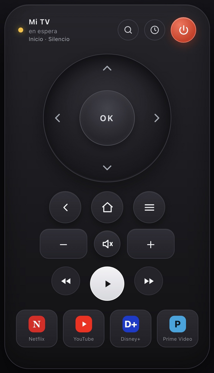

# Xiaomi TV Remote

> [Español](README.md) | **English**

Wi-Fi remote for **Xiaomi TVs running Android TV / Google TV**. Works from a
PC browser, an iPhone, or any phone — no official app, no physical remote, and
no ADB required.

It includes a **Xiaomi-style directional wheel** (drag/swipe, center = OK, hold
to repeat), a CLI, an installable PWA, and systemd autostart.

Tested on a **Xiaomi Mi TV (MiTV-MSSP3)**. It speaks the same protocol as the
Google TV app (ports **6466/6467**), so it should work with other Android TV /
Google TV devices. It does not work with non-Android TVs (Samsung Tizen,
LG webOS, etc.).

<!--
Screenshot: save the image as docs/screenshot.png and uncomment the line below.

-->

## Features

- **Responsive web UI**: wheel, volume, playback, apps, HDMI input and a text
  field. Nothing to install on your phone.
- **PWA**: add it to your iPhone home screen or install it in Chromium.
- **Automatic discovery**: it stores the TV's name and MAC address, so if the
  router changes its IP it finds the TV again and reconnects by itself.
- **CLI**: `tv key HOME`, `tv text "hello"`, `tv app ...`, plus an interactive
  remote.
- **Autostart** at boot through a systemd service.
- **No cloud**: everything goes directly over your local network.

## Requirements

- Android TV / Google TV and your PC on the **same network**.
- Linux with **Python 3.10+** and `python3-venv`.
- Chromium/Chrome only if you want the desktop app window (`tvapp`).
- Ports **6466** and **6467** must be reachable between the PC and the TV
  (this works out of the box on most home networks).

## Installation

```bash
git clone https://github.com/moisesfaponte/xiaomi-tv-remote.git
cd xiaomi-tv-remote
./install.sh
```

The installer creates `.venv/` and installs `androidtvremote2` and `aiohttp`.

### Pair with the TV

The first time you need to pair. The TV must be on and on the same network:

```bash
./tv pair --host <TV-IP>
```

A **6-digit code will appear on the TV**; type it in the terminal. The
certificate is stored in `~/.config/tvremote/` (do not share it: it identifies
your PC to the TV).

## Usage

### Web remote

```bash
./tvweb
```

Open `http://<PC-IP>:8765/` from any device on the network. The server listens
on the whole LAN by default.

- PC only: `./tvweb --bind 127.0.0.1`
- Different port: `./tvweb --port 9000`
- Open the browser automatically: `./tvweb --open`

### Desktop app window

```bash
./tvapp
```

Opens the remote in a Chromium window without browser chrome. If the server is
not running, it starts it. It also shows up in the application menu as
**“Mando Mi TV”** if you create the shortcut (see below).

### The wheel

- **Tap an arrow**: move in that direction.
- **Drag/swipe** around the wheel: the direction changes as you cross each
  zone.
- **Hold** a direction: repeat (handy for long lists).
- **Tap the center (OK)**: select.

Keyboard shortcuts on a PC: arrow keys, Enter, Backspace/Esc, `h` home,
`p` power, `m` mute, `n` Netflix, `y` YouTube, `+`/`-` volume, space
play/pause.

### Install as an app (PWA)

- **PC**: open `http://127.0.0.1:8765/` in Chromium and click the install icon
  in the address bar (or the ⤓ button on the remote).
- **iPhone/phone**: open the URL in Safari → *Share* → *Add to Home Screen*.
  It behaves like a full-screen app icon. (The full service worker requires
  `localhost` or HTTPS; the home-screen shortcut still works over plain HTTP.)

### Terminal remote (alternative)

```bash
./tv                       # interactive remote
./tv key HOME
./tv key DPAD_DOWN
./tv key DPAD_CENTER
./tv key BACK
./tv key POWER
./tv key VOLUME_UP
./tv text "hello"
./tv app https://www.youtube.com
```

## If the TV's IP changes

The remote stores the TV's **identity** (name and MAC address), not just its IP.
If the saved IP stops responding, it:

1. Scans the local subnet (deduced from the PC's IP, /24 by default).
2. Looks for hosts with the remote ports open.
3. Verifies the device is that TV by MAC/name.
4. Updates the IP and reconnects by itself.

Retries are automatic and **stop** as soon as the TV is found. If the TV is off
or unplugged, it keeps retrying with increasing delays (5 s, 8 s, 12 s… up to
30 s) and does not forget the last known IP.

- In the web UI: use the **🔍** button to force a scan.
- In the terminal:

```bash
./tv discover
./tv discover --subnet 192.168.1.0/24
```

You can still pass an IP manually:

```bash
./tv --host 192.168.1.20 key HOME
```

That said, it is best to reserve static IPs for the PC and the TV in your
router: discovery is the safety net.

## Autostart (systemd)

```bash
./install.sh --service
```

Creates `/etc/systemd/system/tvremote.service` for your user, enables it and
starts it. It asks for `sudo`.

```bash
systemctl status tvremote      # check whether it is running
systemctl restart tvremote     # restart it
systemctl stop tvremote        # stop it
systemctl start tvremote       # start it again
systemctl disable tvremote     # do not start it at boot
journalctl -u tvremote -f      # follow the logs
```

After changing the code, `systemctl restart tvremote` applies the changes.

### PC suspend

While the PC is suspended (or hibernating) the service is frozen: no processes
and no network, so the remote does not respond. On resume the server notices
within ~1 second, closes the stale connection and reconnects to the TV by
itself; nothing needs to be restarted. If the PC is fully powered off, the
service starts again at boot (if you enabled it).

### Application menu shortcut (optional)

```bash
mkdir -p ~/.local/share/applications
cat > ~/.local/share/applications/mando-tv.desktop <<EOF
[Desktop Entry]
Type=Application
Name=Mando Mi TV
Comment=Remote control for Xiaomi/Android TV
Exec=$PWD/tvapp
Icon=$PWD/icons/icon-512.png
Terminal=false
Categories=Utility;Network;
EOF
```

## Configuration

Stored in `~/.config/tvremote/`:

| File | Contents |
| --- | --- |
| `config.json` | TV IP, name, MAC address and subnet |
| `cert.pem`, `key.pem` | Pairing certificate (do not share) |

Useful options:

```bash
./tvweb --host <IP> --subnet <CIDR> --port 8765 --bind 0.0.0.0
```

You can also set the `TV_HOST` and `TV_SUBNET` environment variables.

## Security

The web UI has **no authentication**: anyone on your local network can control
the TV while the server is running. It is equivalent to the Google TV app. If
that worries you, use `./tvweb --bind 127.0.0.1` to limit it to the PC, or put
the service behind a proxy with a password.

## Troubleshooting

- **“Not paired”**: run `./tv pair --host <IP>`.
- **No code appears on the TV**: turn the TV on with the physical button and
  try again.
- **“TV unavailable”**: TV is off, on another network, or its IP changed. Try
  `./tv discover`.
- **Not found while scanning**: check the subnet with
  `./tv discover --subnet <CIDR>`; make sure the PC firewall allows outbound
  traffic to 6466/6467 and that the TV is not on an isolated guest network.
- **The service will not start**: `journalctl -u tvremote -n 50`.

## Alternative: full screen with scrcpy

If you enable *ADB debugging* on the TV (Settings → About → tap “Build” 7
times → Developer options → ADB debugging):

```bash
sudo apt install adb scrcpy
adb connect <TV-IP>:5555
scrcpy
```

This is not required to use this remote.

## Files

```
xiaomi-tv-remote/
├── tv              # CLI remote (tvremote.py)
├── tvweb           # web server
├── tvapp           # desktop app window
├── install.sh      # installer (venv + deps + optional systemd)
├── webremote.py    # server + API
├── discovery.py    # find the TV by MAC/name
├── remote.html     # UI (wheel + buttons)
├── manifest.webmanifest, sw.js, icons/
├── requirements.txt
└── .venv/          # created by the installer
```

## License

MIT. See [LICENSE](LICENSE).
