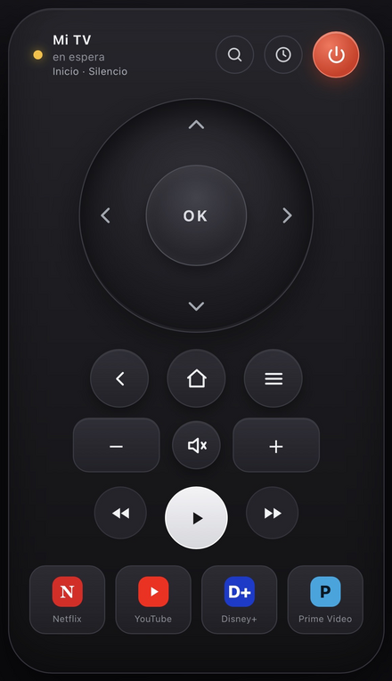

# Xiaomi TV Remote

> **Español** | [English](README.en.md)

Mando remoto por Wi-Fi para televisores **Xiaomi con Android TV / Google TV**.
Funciona desde el navegador del PC, del iPhone o de cualquier móvil, sin la app
oficial, sin mando físico y sin ADB.

Incluye una **rueda direccional tipo Xiaomi** (arrastrar/deslizar, centro = OK,
mantener para repetir), CLI, PWA instalable y arranque automático con systemd.

Probado con una **Xiaomi Mi TV (MiTV-MSSP3)**. Usa el mismo protocolo que la app
Google TV (puertos **6466/6467**), así que debería funcionar con otros
televisores Android TV / Google TV. No funciona con televisores que no sean
Android/Google TV (Samsung Tizen, LG webOS, etc.).

<!--
Captura de pantalla: guarda la imagen en docs/screenshot.png y descomenta
la línea siguiente.

-->

## Características

- **Web responsive**: rueda, volumen, reproducción, apps, entrada HDMI y campo
  de texto. Sin instalar nada en el móvil.
- **PWA**: se puede añadir a la pantalla de inicio del iPhone o instalar como
  app en Chromium.
- **Descubrimiento automático**: guarda el nombre y la MAC de la TV, así que si
  el router le cambia la IP, la encuentra sola y se reconecta.
- **CLI**: `tv key HOME`, `tv text "hola"`, `tv app ...`, mando interactivo.
- **Arranque automático** al encender el PC con un servicio systemd.
- **Sin nube**: todo va directo por la red local.

## Requisitos

- TV Android TV / Google TV y PC en la **misma red**.
- Linux con **Python 3.10+** y `python3-venv`.
- Chromium/Chrome solo si quieres la ventana de app de escritorio (`tvapp`).
- Los puertos **6466** y **6467** deben poder alcanzarse entre el PC y la TV
  (en la mayoría de redes domésticas funciona sin tocar nada).

## Instalación

```bash
git clone https://github.com/moisesfaponte/xiaomi-tv-remote.git
cd xiaomi-tv-remote
./install.sh
```

El instalador crea `.venv/` e instala `androidtvremote2` y `aiohttp`.

### Emparejar con la TV

La primera vez hay que emparejar. La TV debe estar encendida y en la misma red:

```bash
./tv pair --host <IP-de-la-TV>
```

Aparecerá un **código de 6 dígitos en la TV**; escríbelo en el terminal. El
certificado se guarda en `~/.config/tvremote/` (no lo compartas: identifica tu
PC ante la TV).

## Uso

### Mando web

```bash
./tvweb
```

Abre `http://<IP-del-PC>:8765/` desde cualquier dispositivo de la red. El
servidor escucha en toda la LAN por defecto.

- Solo en el PC: `./tvweb --bind 127.0.0.1`
- Otro puerto: `./tvweb --port 9000`
- Abrir el navegador automáticamente: `./tvweb --open`

### Ventana de app de escritorio

```bash
./tvapp
```

Abre el mando en una ventana de Chromium sin barra de navegador. Si el servidor
no está arrancado, lo inicia solo. También aparece en el menú de aplicaciones
como **“Mando Mi TV”** si creas el acceso directo (ver abajo).

### La rueda

- **Toca una flecha**: mueve en esa dirección.
- **Desliza/arrastra** por la rueda: cambia de dirección al pasar por cada zona.
- **Mantén** una dirección: repite (útil para listas largas).
- **Toca el centro (OK)**: selecciona.

Atajos de teclado en el PC: flechas, Enter, Retroceso/Esc, `h` inicio,
`p` encendido, `m` silencio, `n` Netflix, `y` YouTube, `+`/`-` volumen,
espacio play/pausa.

### Instalarlo como app (PWA)

- **PC**: abre `http://127.0.0.1:8765/` en Chromium y pulsa el icono de instalar
  de la barra de direcciones (o el botón ⤓ del mando).
- **iPhone/móvil**: abre la URL en Safari → *Compartir* → *Añadir a pantalla de
  inicio*. Queda como icono a pantalla completa. (El service worker completo
  requiere `localhost` o HTTPS; el acceso directo funciona igual por HTTP).

### Mando por terminal (alternativa)

```bash
./tv                       # mando interactivo
./tv key HOME
./tv key DPAD_DOWN
./tv key DPAD_CENTER
./tv key BACK
./tv key POWER
./tv key VOLUME_UP
./tv text "hola"
./tv app https://www.youtube.com
```

## Si la TV cambia de IP

El mando guarda la **identidad** de la TV (nombre y MAC), no solo la IP. Si la
IP guardada deja de responder:

1. Escanea la subred local (por defecto la deduce de la IP del PC, máscara /24).
2. Busca hosts con los puertos del mando abiertos.
3. Verifica que el dispositivo es esa TV por su MAC/nombre.
4. Actualiza la IP y reconecta sola.

Los reintentos son automáticos y **se detienen** en cuanto la encuentra. Si la
TV está apagada o desenchufada, sigue reintentando con espera creciente
(5 s, 8 s, 12 s… hasta 30 s) y no borra la última IP conocida.

- En la web: botón **🔍** para forzar la búsqueda.
- En el terminal:

```bash
./tv discover
./tv discover --subnet 192.168.1.0/24
```

También se puede indicar una IP manualmente:

```bash
./tv --host 192.168.1.20 key HOME
```

Aun así, lo recomendable es reservar IP fija para el PC y la TV en el router:
el descubrimiento es la red de seguridad.

## Arranque automático (systemd)

```bash
./install.sh --service
```

Crea `/etc/systemd/system/tvremote.service` para tu usuario, lo habilita y lo
arranca. Pide `sudo`.

```bash
systemctl status tvremote      # ver si está funcionando
systemctl restart tvremote     # reiniciarlo
systemctl stop tvremote        # pararlo
systemctl start tvremote       # arrancarlo otra vez
systemctl disable tvremote     # que no arranque al encender el PC
journalctl -u tvremote -f      # ver los mensajes en directo
```

Si cambias el código, `systemctl restart tvremote` aplica los cambios.

### Acceso directo en el menú de aplicaciones (opcional)

```bash
mkdir -p ~/.local/share/applications
cat > ~/.local/share/applications/mando-tv.desktop <<EOF
[Desktop Entry]
Type=Application
Name=Mando Mi TV
Comment=Control remoto para Xiaomi/Android TV
Exec=$PWD/tvapp
Icon=$PWD/icons/icon-512.png
Terminal=false
Categories=Utility;Network;
EOF
```

## Configuración

Se guarda en `~/.config/tvremote/`:

| Archivo | Contenido |
| --- | --- |
| `config.json` | IP, nombre, MAC y subred de la TV |
| `cert.pem`, `key.pem` | Certificado de emparejamiento (no compartir) |

Opciones útiles:

```bash
./tvweb --host <IP> --subnet <CIDR> --port 8765 --bind 0.0.0.0
```

También se puede definir `TV_HOST` y `TV_SUBNET` como variables de entorno.

## Seguridad

La interfaz web **no tiene autenticación**: cualquiera en tu red local puede
controlar la TV mientras el servidor esté encendido. Es equivalente a la app de
Google TV. Si te preocupa, usa `./tvweb --bind 127.0.0.1` para limitarlo al PC,
o pon el servicio detrás de un proxy con contraseña.

## Solución de problemas

- **“No emparejado”**: ejecuta `./tv pair --host <IP>`.
- **El código no aparece en la TV**: enciende la TV con el botón físico y repite.
- **“TV no disponible”**: TV apagada, en otra red o IP cambiada. Prueba
  `./tv discover`.
- **No la encuentra escaneando**: comprueba la subred con
  `./tv discover --subnet <CIDR>`; revisa que el firewall del PC permita la
  salida a 6466/6467 y que la TV no esté en una red de invitados aislada.
- **No arranca el servicio**: `journalctl -u tvremote -n 50`.

## Alternativa: pantalla completa con scrcpy

Si activas *Depuración ADB* en la TV (Ajustes → Información → pulsar
“Compilación” 7 veces → Opciones de desarrollador → Depuración ADB):

```bash
sudo apt install adb scrcpy
adb connect <IP-de-la-TV>:5555
scrcpy
```

No es necesario para usar este mando.

## Archivos

```
xiaomi-tv-remote/
├── tv              # mando CLI (tvremote.py)
├── tvweb           # servidor web
├── tvapp           # ventana de app de escritorio
├── install.sh      # instalador (venv + dependencias + systemd opcional)
├── webremote.py    # servidor + API
├── discovery.py    # búsqueda de la TV por MAC/nombre
├── remote.html     # interfaz (rueda + botones)
├── manifest.webmanifest, sw.js, icons/
├── requirements.txt
└── .venv/          # se crea al instalar
```

## Licencia

MIT. Consulta [LICENSE](LICENSE).
